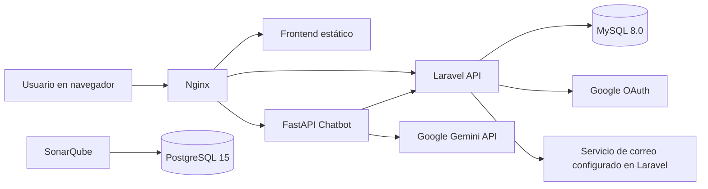

# HGA

HGA es un portal web para la gestión operativa de un hogar geriátrico. El repositorio reúne un frontend multipágina en HTML/CSS/JavaScript, una API backend en Laravel y un microservicio de chatbot en FastAPI. La funcionalidad implementada gira alrededor de autenticación, gestión de residentes, medicamentos, citas médicas, visitas, actividades lúdicas, informes y notificaciones por rol.

## Estado del proyecto

El repositorio muestra desarrollo activo: contiene migraciones recientes de Laravel, pruebas automatizadas en `backend/tests/`, contenedores Docker, un workflow de despliegue del frontend a GitHub Pages y un análisis de SonarQube. No se encontraron releases, changelog ni una licencia explícita en la raíz del repositorio.

## Características principales

- Autenticación con JWT mediante `POST /api/login`, cierre de sesión, consulta de perfil y actualización de perfil.
- Registro de usuarios con asignación forzada de rol según el origen del registro (`public` => tutor, `employee` => enfermero).
- Inicio de sesión con Google OAuth para usuarios del portal.
- Recuperación y restablecimiento de contraseña mediante enlaces de reseteo.
- Gestión de residentes con acceso segmentado por rol.
- CRUD de medicamentos, citas médicas, visitas, actividades lúdicas e informes.
- Dashboard administrativo con métricas agregadas por módulo y serie de actividad de los últimos seis meses.
- Sistema de notificaciones internas (`notificaciones_sistema`) generado al crear, actualizar o eliminar entidades clave.
- Chatbot para tutores, con contexto del portal obtenido desde Laravel y generación de respuesta con Gemini cuando hay clave configurada.
- Paginación y búsqueda en listados de API, con tamaño máximo de página fijado en 5 registros.

## Tecnologías utilizadas

| Categoría | Tecnologías verificadas |
|---|---|
| Frontend | HTML, CSS, JavaScript, Bootstrap |
| Backend | PHP 8.2, Laravel 12, JWT Auth (`tymon/jwt-auth`) |
| Microservicio | Python 3.12, FastAPI, Uvicorn, HTTPX, `google-genai` |
| Base de datos | MySQL 8.0 para la aplicación, PostgreSQL 15 para SonarQube |
| Servidor web | Nginx |
| Build y tooling | Composer, npm, Vite, Tailwind CSS |
| Contenedores | Docker, Docker Compose |
| Calidad | PHPUnit, SonarQube, GitHub Actions |

## Arquitectura

El repositorio presenta una organización compatible con una arquitectura modular por servicios:

- `frontend/` sirve páginas estáticas y consume la API REST del backend.
- `backend/` implementa una API Laravel con capas de `Controllers -> Services -> Repositories -> Models`.
- `chatbot/` expone un servicio FastAPI independiente y consulta al backend para obtener contexto del usuario y del portal.
- `db/hogar_geriatrico.sql` inicializa una base de datos legacy y luego Laravel ejecuta migraciones de reconciliación para alinear el esquema.
- `compose.yml` agrega además una instancia opcional de SonarQube con PostgreSQL.



### Roles y alcance funcional

Los códigos de rol observados en backend son:

- `1`: Administrador
- `2`: Enfermero
- `3`: Tutor

El control de acceso se aplica en `backend/routes/api.php` y `backend/app/Services/AccessScopeService.php`. En la implementación actual:

- Administrador y enfermero se consideran personal (`staff`) y pueden ver todos los residentes y registros asociados.
- Tutor solo puede consultar los residentes asociados a su `doc_id`, sus citas visibles, sus visitas registradas y el chatbot.
- El dashboard está restringido a rol administrador.
- Las operaciones de escritura sobre residentes, medicamentos, informes, citas y actividades están reservadas a administrador/enfermero.

## Requisitos previos

### Opción recomendada: Docker

- Docker Engine
- Docker Compose

### Opción manual

- PHP 8.2 o superior
- Composer
- Node.js y npm
- Python 3.12
- MySQL 8.0

## Instalación

### 1. Clonar el repositorio

```bash
git clone <url-del-repositorio>
cd hga
```

### 2. Elegir modalidad de ejecución

#### Modalidad Docker

1. Crear el archivo de entorno raíz a partir de la plantilla:

Linux/macOS:

```bash
cp .env.example .env
```

PowerShell:

```powershell
Copy-Item .env.example .env
```

2. Completar en `.env` las variables faltantes para backend/chatbot. La plantilla raíz no cubre todas las variables usadas por `compose.yml`.

3. Construir los contenedores:

```bash
docker compose build
```

#### Modalidad local sin Docker

1. Preparar Laravel:

```bash
cd backend
cp .env.example .env
composer install
npm install
php artisan key:generate
php artisan migrate
```

2. Preparar el chatbot:

```bash
cd ../chatbot
python -m venv .venv
source .venv/bin/activate
pip install -r requirements.txt
```

En PowerShell, la activación equivalente es:

```powershell
.\.venv\Scripts\Activate.ps1
```

3. Ajustar la configuración del frontend en `frontend/js/api-config.js`, ya que el archivo actual apunta a URLs remotas hardcodeadas.

## Configuración

### Archivos de entorno detectados

- `.env.example`: plantilla raíz pensada para Docker Compose.
- `backend/.env.example`: plantilla del backend Laravel.
- `.env`: archivo consumido por `compose.yml` mediante `env_file`.

### Variables de entorno relevantes

La siguiente tabla resume las variables verificadas en el código o en `compose.yml`. No incluye toda la superficie estándar de Laravel, que puede consultarse adicionalmente en `backend/.env.example`.

| Variable | Obligatoria | Valor de ejemplo | Descripción |
|---|---:|---|---|
| `APP_NAME` | Sí | `HGA` | Nombre lógico de la aplicación Laravel. |
| `APP_ENV` | Sí | `local` | Entorno de ejecución del backend. |
| `APP_DEBUG` | Sí | `true` | Habilita trazas de depuración en Laravel. |
| `APP_KEY` | Sí | `base64:clave-generada-segura` | Clave de cifrado del backend Laravel. |
| `APP_URL` | Sí | `http://localhost:8000` | URL pública del backend. |
| `DB_CONNECTION` | Sí | `mysql` | Driver de base de datos usado por Laravel. |
| `DB_HOST` | Sí | `db` | Host de la base de datos de la aplicación. |
| `DB_PORT` | Sí | `3306` | Puerto de MySQL. |
| `DB_DATABASE` | Sí | `hogar_geriatrico` | Base de datos usada por Laravel. |
| `DB_USERNAME` | Sí | `hga_user` | Usuario de conexión a MySQL. |
| `DB_PASSWORD` | Sí | `cambia-esta-clave` | Contraseña de conexión a MySQL. |
| `DB_SSL_CA` | No | `/etc/mysql/certs/ca.pem` | Certificado CA para conexiones MySQL por SSL. |
| `MYSQL_ROOT_PASSWORD` | Sí | `cambia-root-password` | Contraseña del usuario root de MySQL en Docker. |
| `MYSQL_DATABASE` | Sí | `hogar_geriatrico` | Base creada al inicializar el contenedor MySQL. |
| `MYSQL_USER` | Sí | `hga_user` | Usuario de aplicación creado al iniciar MySQL. |
| `MYSQL_PASSWORD` | Sí | `cambia-esta-clave` | Contraseña del usuario `MYSQL_USER`. |
| `JWT_SECRET` | Sí | `clave-jwt-segura` | Secreto usado para firmar tokens JWT del backend. |
| `GOOGLE_CLIENT_ID` | No | `tu-cliente.apps.googleusercontent.com` | Cliente OAuth de Google para login social. |
| `GOOGLE_CLIENT_SECRET` | No | `tu-google-client-secret` | Secreto OAuth de Google. |
| `GOOGLE_REDIRECT_URI` | No | `http://localhost/api/auth/google/callback` | Callback OAuth del backend. |
| `GOOGLE_FRONTEND_REDIRECT` | No | `http://localhost/login.html` | URL de retorno del frontend tras autenticación o recuperación. |
| `MAIL_MAILER` | No | `smtp` | Driver de correo de Laravel usado en recuperación de contraseña. |
| `MAIL_HOST` | No | `smtp.example.com` | Host SMTP. |
| `MAIL_PORT` | No | `587` | Puerto SMTP. |
| `MAIL_USERNAME` | No | `usuario_smtp` | Usuario SMTP. |
| `MAIL_PASSWORD` | No | `clave_smtp` | Contraseña SMTP. |
| `MAIL_FROM_ADDRESS` | No | `noreply@example.com` | Correo remitente de notificaciones. |
| `MAIL_FROM_NAME` | No | `HGA` | Nombre remitente de correos. |
| `BACKEND_API_URL` | No | `http://app:8000/api` | URL base que usa el chatbot para consultar el backend. |
| `GEMINI_API` | No | `tu-api-key-de-gemini` | Habilita respuestas generadas por Gemini en el chatbot. |
| `CHATBOT_CORS_ORIGINS` | No | `http://localhost,http://127.0.0.1` | Lista de orígenes permitidos por FastAPI. Si no existe, usa `*`. |
| `CHATBOT_RATE_LIMIT` | No | `12` | Máximo de mensajes por ventana de tiempo en el chatbot. Por defecto: `12`. |
| `CHATBOT_RATE_WINDOW` | No | `60` | Ventana del rate limit en segundos. Por defecto: `60`. |

## Ejecución

### Desarrollo local

#### Backend Laravel

Desde `backend/`:

```bash
composer run dev
```

Ese script levanta en paralelo:

- `php artisan serve`
- `php artisan queue:listen`
- `php artisan pail`
- `npm run dev`

#### Chatbot FastAPI

Desde `chatbot/`:

```bash
uvicorn main:app --host 0.0.0.0 --port 8001 --reload
```

#### Frontend estático

El frontend no tiene un servidor de desarrollo propio ni scripts npm en la raíz. Puede servirse con cualquier servidor estático, pero para que funcione en local hay que revisar antes `frontend/js/api-config.js`, que actualmente apunta a URLs remotas.

### Ejecución con Docker

```bash
docker compose build
docker compose up -d
```

Puntos de acceso esperados según `compose.yml`:

- Frontend: `http://localhost`
- Backend Laravel: `http://localhost:8000`
- SonarQube: `http://localhost:9000`

Comprobaciones útiles:

```bash
docker compose logs -f
docker compose exec app php artisan migrate --force
```

### Producción

El repositorio sí contiene imágenes reproducibles para backend y chatbot mediante `Dockerfile`, además de `nginx.conf` para servir el frontend estático. No se encontraron manifiestos de Kubernetes, Terraform ni un flujo de despliegue completo para backend/chatbot en producción.

La única automatización de despliegue encontrada es:

- `.github/workflows/deploy-pages.yml`: publica `frontend/` en GitHub Pages al hacer push a `main`.

## Uso

### Verificación rápida de servicios

Backend Laravel:

```http
GET /api/test
```

Respuesta esperada:

```json
{
  "success": true,
  "message": "Backend working!"
}
```

Health check de Laravel:

```http
GET /up
```

### Inicio de sesión

```http
POST /api/login
Content-Type: application/json

{
  "email": "tutor@example.com",
  "password": "password123"
}
```

La API devuelve `access_token`, `token_type`, `expires_in` y el perfil del usuario cuando la autenticación es correcta.

### Perfil autenticado

```http
GET /api/me
Authorization: Bearer <token>
Accept: application/json
```

### Horarios disponibles para visitas

```http
GET /api/visitas/available-time-slots?date=2026-06-23
Authorization: Bearer <token>
Accept: application/json
```

El backend valida:

- solo lunes a viernes;
- bloques de una hora entre `09:00` y `16:00`;
- máximo 6 visitas globales por día;
- máximo 3 visitas por residente por día;
- máximo 1 visita por tutor por semana.

### Chatbot

El frontend consume el proxy `/chatbot-api/chat`, que en Nginx redirige al servicio FastAPI.

Ejemplo de solicitud directa al chatbot:

```http
POST /chat
Authorization: Bearer <token>
Content-Type: application/json

{
  "message": "¿Qué actividades tiene mi familiar?",
  "is_first_message": true,
  "history": []
}
```

El chatbot está restringido a usuarios con rol tutor. Si `GEMINI_API` no está configurada, responde con un mensaje informativo; si Gemini falla, usa respuestas de respaldo basadas en el contexto obtenido desde Laravel.

## Comandos disponibles

| Comando | Descripción |
|---|---|
| `docker compose build` | Construye las imágenes definidas en `compose.yml`. |
| `docker compose up -d` | Inicia el stack completo en segundo plano. |
| `docker compose down` | Detiene los servicios del stack. |
| `docker compose logs -f` | Muestra logs agregados de los contenedores. |
| `docker compose exec app php artisan migrate --force` | Ejecuta migraciones manualmente dentro del contenedor Laravel. |
| `docker compose exec app php artisan test` | Ejecuta la suite de pruebas del backend dentro del contenedor. |
| `cd backend && composer run dev` | Arranca servidor Laravel, cola, logs y Vite en desarrollo local. |
| `cd backend && composer run test` | Ejecuta las pruebas del backend fuera de Docker. |
| `cd backend && npm run build` | Genera los assets frontend del backend Laravel con Vite. |
| `cd chatbot && pip install -r requirements.txt` | Instala dependencias del chatbot. |
| `cd chatbot && uvicorn main:app --host 0.0.0.0 --port 8001 --reload` | Inicia el chatbot en desarrollo local. |

## Estructura del proyecto

```text
hga/
├── .github/workflows/     # Workflows de GitHub Actions (Pages y SonarQube)
├── backend/               # API Laravel, pruebas, migraciones y seeders
├── chatbot/               # Microservicio FastAPI para el asistente virtual
├── db/                    # SQL inicial legacy usado por MySQL en Docker
├── documentation/         # PDFs de apoyo
├── frontend/              # Sitio estático multipágina y scripts del navegador
├── scripts/               # Script de inicialización Docker
├── compose.yml            # Orquestación local de servicios
├── Dockerfile             # Imágenes del backend PHP y del chatbot Python
├── Makefile               # Atajos para Docker y tareas frecuentes
├── nginx.conf             # Proxy inverso y publicación del frontend
└── sonar-project.properties # Configuración base para SonarQube
```

## API

La API no publica una especificación OpenAPI en el repositorio, pero las rutas verificadas están definidas en `backend/routes/api.php`.

### Autenticación y perfil

| Método | Ruta | Propósito |
|---|---|---|
| `POST` | `/api/register` | Registrar usuario. |
| `POST` | `/api/login` | Autenticar usuario y emitir JWT. |
| `POST` | `/api/logout` | Invalidar sesión actual. |
| `GET` | `/api/me` | Obtener perfil autenticado. |
| `PUT` | `/api/me` | Actualizar perfil autenticado. |
| `GET` | `/api/auth/google` | Iniciar OAuth con Google. |
| `GET` | `/api/auth/google/callback` | Completar OAuth con Google. |
| `POST` | `/api/user/forgot_password` | Solicitar recuperación de contraseña. |
| `POST` | `/api/user/forgot_password/reset` | Restablecer contraseña. |

### Módulos principales

| Recurso | Rutas verificadas | Observaciones |
|---|---|---|
| Residentes | `GET /api/residentes`, `GET /api/residentes/{id}`, `POST/PUT/DELETE /api/residentes` | Tutores solo leen sus residentes asociados. |
| Medicamentos | `apiResource /api/medicamentos` | Escritura reservada a administrador/enfermero. |
| Visitas | `apiResource /api/visitas`, `GET /api/visitas/calendar`, `GET /api/visitas/available-time-slots` | Incluye reglas de agenda y aforo. |
| Citas | `apiResource /api/citas` | Lectura para tutor; escritura restringida. |
| Actividades | `apiResource /api/actividades` | Tutores solo leen. |
| Informes | `apiResource /api/informes` | Solo personal puede operar. |
| Notificaciones | `GET /api/notificaciones`, `PATCH /api/notificaciones/read-all`, `PATCH /api/notificaciones/{id}/read` | Lectura y marcado por usuario autenticado. |
| Dashboard | `GET /api/dashboard` | Disponible solo para rol administrador. |
| Chatbot context | `GET /api/chatbot/context`, `GET /api/chatbot/viewer-context` | Consumido por el microservicio FastAPI. |

### Convenciones de consulta

Los controladores que heredan de `backend/app/Http/Controllers/Controller.php` soportan:

- `page`
- `per_page` (máximo efectivo: `5`)
- `search`
- `paginate=true`

## Modelo de datos

La persistencia principal está en MySQL. El repositorio contiene dos fuentes de esquema:

- `db/hogar_geriatrico.sql`: dump legacy para inicialización de la base.
- `backend/database/migrations/`: migraciones activas de Laravel, incluidas varias de reconciliación de nombres y columnas.

### Entidades principales verificadas

| Tabla/modelo | Clave principal | Propósito |
|---|---|---|
| `usuario` / `App\Models\usuarios` | `doc_id` | Usuarios del sistema y autenticación. |
| `residente` / `App\Models\residentes` | `cod_residente` | Residentes del hogar y vínculo con tutor (`cod_usuario`). |
| `medicamentos` | `Cod_medicamento` | Registro de medicamentos y stock por residente. |
| `citas` / `App\Models\citas` | `cod_cita` | Citas médicas asociadas a residentes. |
| `visita` / `App\Models\visitas` | `id` | Visitas de familiares o tutores a residentes. |
| `actividades_ludicas` | `Cod_acti_ludi` | Actividades recreativas programadas. |
| `informes` | `cod_Informes` | Informes por residente. |
| `notificaciones_sistema` | `id` | Notificaciones internas por destinatario. |

### Relaciones funcionales observadas

- `residente.cod_usuario` vincula un residente con el tutor responsable.
- `citas.cod_Residente`, `visita.cod_Residente`, `medicamentos.cod_residente`, `informes.cod_Residente` y `actividades_ludicas.cod_residente` enlazan información clínica u operativa con un residente.
- `notificaciones_sistema.recipient_doc_id` y `actor_doc_id` relacionan eventos con usuarios destinatarios y ejecutores.

### Migraciones y semillas

- Las migraciones se ejecutan automáticamente al iniciar el contenedor `app`.
- `DatabaseSeeder` encadena seeders de usuarios, residentes, medicamentos, visitas, informes, citas y actividades.
- Las pruebas del backend usan SQLite en memoria (`phpunit.xml`), no MySQL real.

## Pruebas

El repositorio solo contiene pruebas automatizadas verificables para el backend Laravel.

### Framework y ubicación

- Framework: PHPUnit 11
- Ubicación: `backend/tests/Unit` y `backend/tests/Feature`

### Casos cubiertos de forma explícita

- Restricciones de acceso por rol y alcance por tutor.
- Paginación y filtrado por colección.
- Generación de códigos de medicamentos.
- Migración que añade `cod_usuario` a `citas`.
- Contexto filtrado del chatbot.

### Ejecución

Dentro de `backend/`:

```bash
composer run test
```

O dentro del contenedor:

```bash
docker compose exec app php artisan test
```

No se encontraron pruebas automatizadas para `frontend/` ni para `chatbot/`.

## Despliegue

### Evidencia encontrada

- `Dockerfile` crea una imagen `app` basada en `php:8.2-cli` y una imagen `chatbot` basada en `python:3.12-slim`.
- `compose.yml` define los servicios `db`, `app`, `frontend`, `chatbot`, `sonarqube` y `postgres_db`.
- `.github/workflows/deploy-pages.yml` despliega `frontend/` a GitHub Pages.
- `.github/workflows/sonar.yml` ejecuta análisis SonarQube al hacer push a la rama `dev`.

### Lo que no se pudo verificar

- No se encontraron scripts de rollback.
- No se encontraron despliegues codificados para infraestructura cloud del backend o del chatbot.
- No se encontró una especificación de observabilidad más allá de logs y SonarQube.

## Solución de problemas

### El frontend local no consume el backend del stack Docker

`frontend/js/api-config.js` contiene URLs remotas hardcodeadas (`BACKEND_URL` y `CHATBOT_URL`). Mientras ese archivo no se adapte al entorno local, las páginas HTML no usarán automáticamente el backend y el chatbot levantados en `localhost`.

### El `Makefile` usa `docker-compose`

Los targets del `Makefile` invocan `docker-compose`, mientras que el entorno analizado sí aceptó `docker compose`. En instalaciones modernas con el plugin Compose v2 puede ser necesario ejecutar los comandos manualmente con espacio en lugar de guion.

### `.env.example` no cubre toda la configuración del stack

La plantilla raíz no incluye al menos `GEMINI_API`, `CHATBOT_RATE_LIMIT`, `CHATBOT_RATE_WINDOW` ni `DB_SSL_CA`, aunque `compose.yml` sí las consume.

### La plantilla OAuth del backend no coincide con el frontend servido por Nginx

`backend/.env.example` propone `GOOGLE_FRONTEND_REDIRECT=http://localhost/frontend/login.html`, pero `nginx.conf` publica los HTML del frontend desde `/usr/share/nginx/html` en la raíz del sitio. Para una ejecución local con Nginx, la ruta esperable es `http://localhost/login.html` o `http://localhost/login_employees.html`.

### La URL `/admin` no está respaldada por rutas verificadas

El `Makefile` y `scripts/init.sh` sugieren `http://localhost:8000/admin`, pero en `backend/routes/web.php` solo se verificó la ruta `/`.

### Dos fuentes de esquema conviven al arrancar el stack

MySQL se inicializa con `db/hogar_geriatrico.sql` y luego Laravel ejecuta migraciones. Esto puede generar diferencias si el dump y las migraciones dejan de estar alineados.

## Seguridad

- No se deben versionar archivos `.env` ni credenciales reales.
- El backend usa JWT para autenticación API y Google OAuth como autenticación social opcional.
- El chatbot valida autenticación y restringe su uso al rol tutor.
- No se encontró un archivo `SECURITY.md` ni un procedimiento formal para reportar vulnerabilidades.

## Contribución

No se encontró una guía formal de contribución. Para cambios seguros en este repositorio conviene:

1. Trabajar sobre una rama propia.
2. Validar el backend con `composer run test` o `docker compose exec app php artisan test`.
3. Si se toca el frontend, verificar manualmente las páginas afectadas y la configuración de `frontend/js/api-config.js`.
4. Mantener sincronizados el dump `db/hogar_geriatrico.sql` y las migraciones de Laravel si ambos siguen siendo parte del flujo de arranque.

## Licencia

No se encontró un archivo `LICENSE` en la raíz del repositorio. El subproyecto Laravel declara licencia `MIT` en `backend/composer.json`, pero eso no equivale a una licencia explícita para todo el repositorio HGA.
